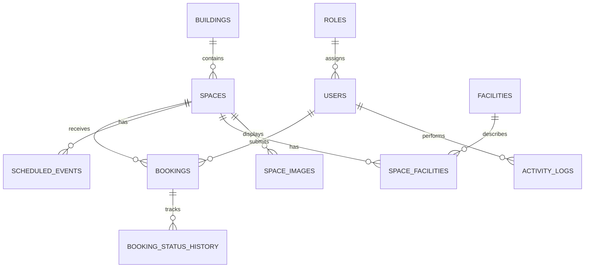

# StudySpace — ER Diagram and Database Design

## 1. Purpose

The ER diagram describes the main entities in the StudySpace database and their relationships. The database will manage campus users, buildings, rooms, facilities, scheduled events, and reservations.

## 2. Main Entities

### Roles
Stores the roles assigned to users.

- role_id — Primary Key
- role_name — Unique role name, such as Student, Faculty, Staff, or Admin

### Users
Stores user account information.

- user_id — Primary Key
- role_id — Foreign Key referencing Roles
- display_name
- email — Unique
- password_hash

### Buildings
Stores campus building information.

- building_id — Primary Key
- building_name — Unique building name
- location

### Spaces
Stores rooms and other bookable campus spaces.

- space_id — Primary Key
- building_id — Foreign Key referencing Buildings
- space_name
- space_type
- capacity
- status

### Facilities
Stores available facilities, such as projectors, whiteboards, and computers.

- facility_id — Primary Key
- facility_name — Unique

### SpaceFacilities
Connects spaces with their facilities.

- space_id — Foreign Key referencing Spaces
- facility_id — Foreign Key referencing Facilities
- Composite Primary Key: space_id and facility_id

### Bookings
Stores reservation requests and booking details.

- booking_id — Primary Key
- user_id — Foreign Key referencing Users
- space_id — Foreign Key referencing Spaces
- activity_type
- start_time
- end_time
- status

### ScheduledEvents
Stores existing classes and other scheduled activities that make a space unavailable.

- event_id — Primary Key
- space_id — Foreign Key referencing Spaces
- event_name
- start_time
- end_time
- event_type

### BookingStatusHistory
Tracks changes to booking status.

- history_id — Primary Key
- booking_id — Foreign Key referencing Bookings
- old_status
- new_status
- changed_at

### SpaceImages
Stores references to room images held in cloud storage.

- image_id — Primary Key
- space_id — Foreign Key referencing Spaces
- blob_name

### ActivityLogs
Records important actions performed in the application.

- log_id — Primary Key
- actor_id — Foreign Key referencing Users
- action
- created_at

## 3. Entity Relationships

- One role can be assigned to many users.
- One building can contain many spaces.
- One user can submit many bookings.
- One space can have many bookings over time.
- One space can have many scheduled events.
- Spaces and facilities have a many-to-many relationship through SpaceFacilities.
- One booking can have many status-history records.
- One space can have multiple image references.
- One user can perform many logged activities.

## 4. Important Database Rules

1. Every primary key must uniquely identify a record.
2. Foreign keys must reference valid records.
3. A booking's end time must be later than its start time.
4. Only authorized users can perform restricted actions.
5. Overlapping confirmed bookings for the same space must be prevented.
6. Existing scheduled events must be checked before a booking is confirmed.
7. Booking and approval status values must be restricted to valid choices.

## 5. Normalization

The planned tables separate users, roles, buildings, spaces, facilities, bookings, and events to reduce duplicate information.

The SpaceFacilities table resolves the many-to-many relationship between spaces and facilities. The design will be checked for Third Normal Form (3NF) during SQL implementation.

## 6. Implementation Note

This is the proposed logical database design. Column data types, additional constraints, indexes, approval fields, and exact SQL definitions will be finalized during implementation.

